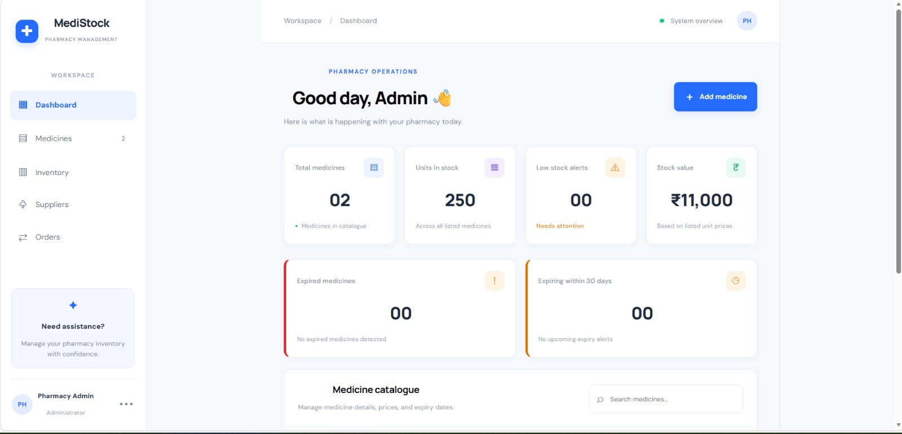
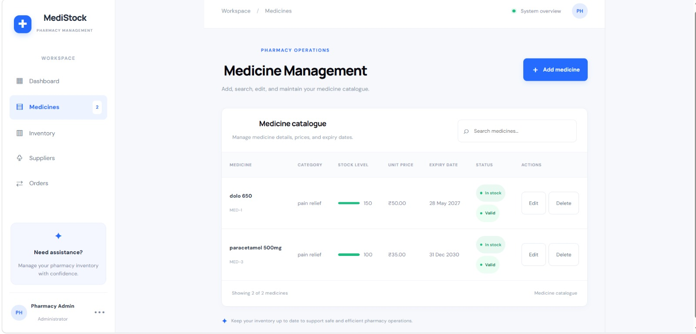
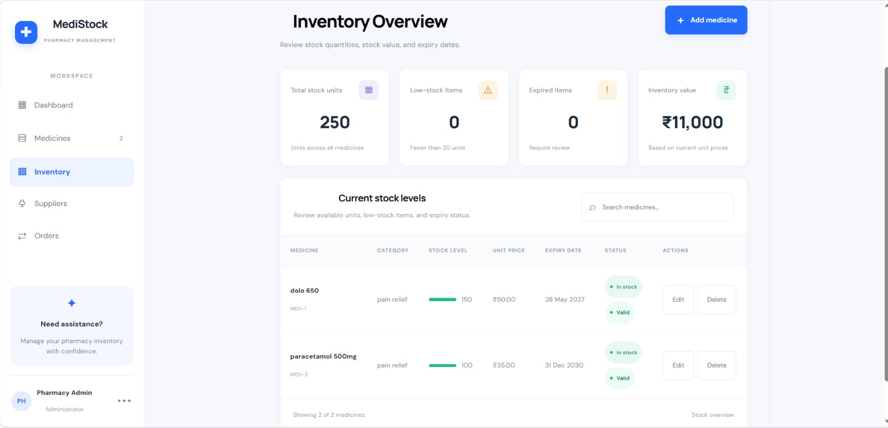
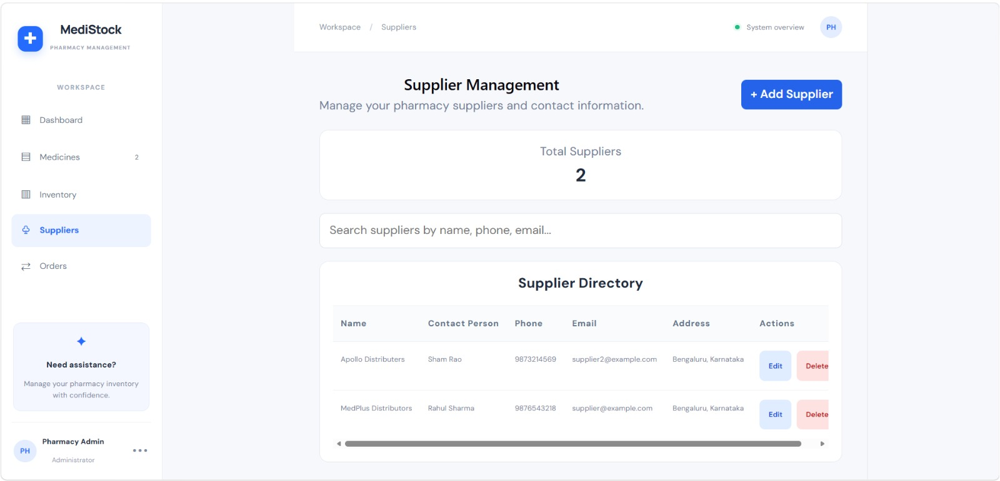
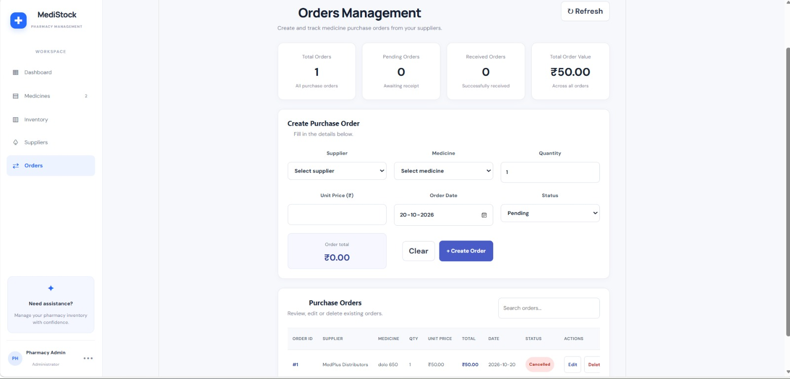

# MediStock — Pharmacy Management System

MediStock is a full-stack pharmacy inventory management application built to manage medicines, suppliers, and purchase orders through a web-based interface. It uses a React and TypeScript frontend, a Spring Boot REST API, and PostgreSQL for persistent data storage.

## Features

- **Medicine management:** Create, view, update, and delete medicine records.
- **Inventory overview:** View medicine stock and price information.
- **Stock and expiry visibility:** Review low-stock and expiry-related alerts shown by the application.
- **Supplier management:** Create, view, update, and delete supplier records.
- **Purchase order management:** Create, view, update, and delete purchase orders.
- **Order status workflow:** Track orders using `Pending`, `Received`, and `Cancelled` statuses.
- **Stock adjustment on receipt:** Marking an order as `Received` adds its quantity to the associated medicine's stock. Changing a received order to `Cancelled` reverses that quantity.
- **Persistent storage:** Medicine, supplier, and order data are stored in PostgreSQL.
- **REST API:** The frontend communicates with the Spring Boot backend over HTTP.

> **Development note:** The current local configuration is intended for development. Configure appropriate authentication, authorization, secrets management, and production deployment settings before using the application in a real pharmacy or exposing it to the internet.

## Technology Stack

| Layer | Technology |
|---|---|
| Frontend | React, TypeScript, Vite |
| Backend | Java 17, Spring Boot, Maven |
| Persistence | Spring Data JPA / Hibernate |
| Database | PostgreSQL |
| API style | REST |
| Styling | CSS |

## Project Structure

```text
Pharma Management/
├── backend/
│   ├── mvnw
│   ├── mvnw.cmd
│   └── src/
│       └── main/
│           ├── java/com/pharmacy/backend/
│           └── resources/
│               └── application.properties
└── frontend/
    ├── package.json
    ├── src/
    │   ├── App.tsx
    │   ├── App.css
    │   ├── Suppliers.tsx
    │   ├── Orders.tsx
    │   └── Orders.css
    └── ...
```

*The tree highlights key files; generated files and additional source files are omitted.*

## Prerequisites

Install the following before running MediStock locally:

- **Java 17**
- **Node.js and npm** (a current LTS release is recommended)
- **PostgreSQL** (the project was developed with PostgreSQL 17)
- A terminal and a code editor such as Visual Studio Code

The backend includes the Maven Wrapper, so a separate Maven installation is not normally required.

## Database Setup

1. Start PostgreSQL.
2. Open a PostgreSQL client such as `psql` or pgAdmin.
3. Create the application database:

   ```sql
   CREATE DATABASE pharmacy_db;
   ```

4. Configure the database connection in `backend/src/main/resources/application.properties`.

   Example local configuration (use your own local credentials):

   ```properties
   spring.datasource.url=jdbc:postgresql://localhost:5432/pharmacy_db
   spring.datasource.username=postgres
   spring.datasource.password=YOUR_LOCAL_POSTGRES_PASSWORD

   spring.jpa.hibernate.ddl-auto=update
   server.port=8081
   ```

   Keep your actual password private. Do not commit real credentials to a public repository. If your local configuration uses different values, preserve those values locally and update the example accordingly.

Hibernate is configured to update the schema automatically in the development setup. For production use, adopt a managed schema migration approach and review database permissions and backup requirements.

## Run the Backend

Open a terminal in the `backend` directory:

**Windows (PowerShell / Command Prompt):**

```powershell
.\mvnw.cmd spring-boot:run
```

To compile the backend without starting it:

```powershell
.\mvnw.cmd compile
```

The backend is configured to run at:

```text
http://localhost:8081
```

Keep this terminal open while using the frontend.

## Run the Frontend

Open a second terminal in the `frontend` directory:

```bash
npm install
npm run dev
```

Vite prints the local development URL in the terminal. It is commonly `http://localhost:5173`; if that port is already in use, Vite may choose another port, such as `5174`.

If the frontend runs on a different port, ensure the backend CORS configuration permits that origin.

## API Endpoints

The backend exposes the following REST endpoints:

| Resource | Method | Endpoint | Purpose |
|---|---|---|---|
| Medicines | `GET` | `/api/medicines` | List medicines |
| Medicines | `GET` | `/api/medicines/{id}` | Retrieve a medicine by ID, if supported by the controller |
| Medicines | `POST` | `/api/medicines` | Create a medicine |
| Medicines | `PUT` | `/api/medicines/{id}` | Update a medicine |
| Medicines | `DELETE` | `/api/medicines/{id}` | Delete a medicine |
| Suppliers | `GET` | `/api/suppliers` | List suppliers |
| Suppliers | `POST` | `/api/suppliers` | Create a supplier |
| Suppliers | `PUT` | `/api/suppliers/{id}` | Update a supplier |
| Suppliers | `DELETE` | `/api/suppliers/{id}` | Delete a supplier |
| Orders | `GET` | `/api/orders` | List orders |
| Orders | `GET` | `/api/orders/{id}` | Retrieve an order by ID |
| Orders | `POST` | `/api/orders` | Create an order |
| Orders | `PUT` | `/api/orders/{id}` | Update an order |
| Orders | `DELETE` | `/api/orders/{id}` | Delete an order, subject to received-order rules |

All endpoints are relative to `http://localhost:8081` in the local development setup. The medicine-by-ID row should be retained only if that mapping exists in your current `MedicineController`.

### Purchase order stock behavior

- A new order with status `Received` adds its ordered quantity to the selected medicine's stock.
- Updating an order that was already `Received` first reverses its previous stock contribution, then applies the updated order's contribution.
- Changing an order from `Received` to `Cancelled` removes the quantity previously added by that order.
- A `Received` order cannot be deleted directly. Change its status to `Cancelled` first if that reflects the intended inventory correction, then delete it if needed.
- The API validates key order fields and prevents stock adjustments that would produce negative inventory.

## Testing Checklist

Use this checklist for a manual smoke test after starting PostgreSQL, the backend, and the frontend:

- [ ] Add a medicine and confirm it appears in the medicine list.
- [ ] Edit the medicine and confirm the changes persist.
- [ ] Delete a temporary medicine.
- [ ] Add, edit, and delete a supplier.
- [ ] Create a purchase order with status `Pending`.
- [ ] Change the order status to `Received` and confirm the associated stock increases by the order quantity.
- [ ] Save an already received order without changing its quantity and confirm stock is not added twice.
- [ ] Change the received order to `Cancelled` and confirm the stock contribution is reversed.
- [ ] Try invalid order values, such as a zero or negative quantity, and confirm the API rejects them.
- [ ] Restart the backend and confirm saved data remains in PostgreSQL.

The stock receipt and cancellation flow has been manually checked during development. Complete the remaining checklist items before describing all of them as tested.

## Screenshots


### Dashboard

!
## Screenshots

### Dashboard


### Medicine Management


### Inventory


### Supplier Management


### Purchase Orders



## Local Configuration and Security

- Do not commit database passwords, API secrets, or other credentials.
- The local backend configuration is for development, not production.
- Review `SecurityConfig` before deployment. If the current setup disables authentication and permits these API routes for development, do not expose it publicly as-is.
- Configure production CORS origins explicitly instead of allowing development origins.
- Use HTTPS, appropriate authentication and authorization, database backups, and a reviewed deployment configuration before real-world use.

## Future Improvements

Possible future enhancements (not represented as currently implemented features) include:

- Automated backend and frontend test suites
- User authentication and role-based access control
- Dashboard analytics and reporting
- Pagination and search/filter improvements
- Database migrations and production deployment
- Audit logging for inventory changes

## Author

**Kshama S. Hiremath**

B.E. — Information Science and Engineering

BMS Institute of Technology and Management, Bengaluru

---

*Built as a full-stack software engineering project to practice frontend development, REST API design, database integration, and inventory workflow management.*
